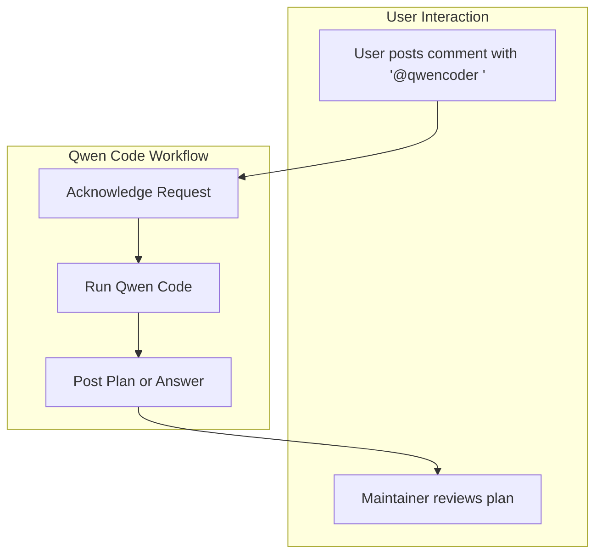

# Qwen Code Assistant

In this guide you will learn how to use the Qwen Code Assistant via GitHub Actions. It serves as an on-demand collaborator you can quickly delegate work to, invoked directly in GitHub Pull Request and Issue comments to perform a wide range of tasks—from code analysis to implementation planning. When you invoke the workflow via `@qwencoder`, it uses a customizable set of read-only tools to understand the context, answer your request or propose a plan, and respond within the same thread.

- [Qwen Code Assistant](#qwen-code-assistant)
  - [Overview](#overview)
  - [Features](#features)
  - [Setup](#setup)
    - [Prerequisites](#prerequisites)
    - [Setup Methods](#setup-methods)
  - [Dependencies](#dependencies)
  - [Usage](#usage)
    - [Supported Triggers](#supported-triggers)
    - [How to Invoke the Qwen Code Workflow](#how-to-invoke-the-qwen-code-workflow)
  - [Interaction Flow](#interaction-flow)
  - [Configuration](#configuration)
  - [Examples](#examples)
    - [Asking a Question](#asking-a-question)
    - [Requesting a Code Change](#requesting-a-code-change)
    - [Summarizing an Issue](#summarizing-an-issue)

## Overview

Unlike specialized Qwen Code workflows for [pull request reviews](../pr-review) or [issue triage](../issue-triage), the Qwen Code Assistant is designed to handle a broad variety of requests, from answering questions about the code to proposing detailed implementation plans, as demonstrated further in this document. It does not modify code itself; a maintainer carries out any proposed changes.

## Features

- **Conversational Interface**: You can interact with the Qwen Code AI assistant directly in GitHub Issue and PR comments.
- **Repository Interaction**: The Qwen Code can read files, view diffs in Pull Requests, and inspect Issue details.
- **Implementation Plans**: For change requests, the Qwen Code posts a step-by-step plan that a maintainer can review and implement.
- **Customizable Toolset**: You can define exactly which read-only tools the Qwen Code AI is allowed to use.
- **Flexible Prompting**: You can tailor the Qwen Code's role, instructions, and guidelines to fit your project's needs.

## Setup

For detailed setup instructions, including prerequisites and authentication, please refer to the main [Getting Started](../../../README.md#quick-start) section and [Authentication documentation](../../../docs/authentication.md).

### Prerequisites

Add the following entries to your `.gitignore` file to prevent Qwen Code artifacts from being committed:

```gitignore
# qwen-code settings
.qwen/

# GitHub App credentials
gha-creds-*.json
```

### Setup Methods

To use this workflow, you can utilize either of the following methods:

1. Run the `/setup-github` command in Qwen Code on your terminal to set up workflows for your repository.
2. Copy the workflow files into your repository's `.github/workflows` directory:

```bash
mkdir -p .github/workflows
curl -o .github/workflows/qwen-dispatch.yml https://raw.githubusercontent.com/QwenLM/qwen-code-action/main/examples/workflows/qwen-dispatch/qwen-dispatch.yml
curl -o .github/workflows/qwen-invoke.yml https://raw.githubusercontent.com/QwenLM/qwen-code-action/main/examples/workflows/qwen-assistant/qwen-invoke.yml
```

> workflows. If you are only setting up `qwen-invoke.yml`, you should comment out or
> remove the other jobs in your copy of `qwen-dispatch.yml`.
> **Note:** The `qwen-dispatch.yml` workflow is designed to call multiple
> workflows. If you are only setting up `qwen-invoke.yml`, you should comment out or
> remove the other jobs in your copy of `qwen-dispatch.yml`.

## Dependencies

This workflow relies on the [qwen-dispatch.yml](../qwen-dispatch/qwen-dispatch.yml) workflow to route requests to the appropriate workflow.

## Usage

### Supported Triggers

The Qwen Code Assistant workflow is triggered by new comments in:

- GitHub Pull Request reviews
- GitHub Pull Request review comments
- GitHub Issues

The Qwen Code Assistant workflow is intentionally configured *not* to respond to comments containing `/review` or `/triage` to avoid conflicts with other dedicated workflows (such as [the Qwen Code Pull Request workflow](../pr-review) or [the issue triage workflow](../issue-triage)).

### How to Invoke the Qwen Code Workflow

To use the general Qwen Code workflow, just mention `@qwencoder` in a comment in a GitHub Pull Request or an Issue, followed by your request. For example:

```
@qwencoder Please explain what the `main.go` file does.
```

```
@qwencoder Propose a plan to refactor the `calculateTotal` function in `src/utils.js` to improve readability.
```

## Interaction Flow

The assistant operates in a read-only planning role: it can read repository data and post comments, but it has no tools that modify code, branches, files, or pull requests. Any code changes in its plan must be carried out by a maintainer.



1. **Acknowledge**: The action first posts a brief comment to let the user know the request has been received.
2. **Analyze**: The agent gathers context through read-only GitHub tools (issues, pull request diffs, file contents).
3. **Respond**: The agent posts its answer or a step-by-step plan as a comment. Plans are advisory; a maintainer decides whether to implement them.

## Configuration

The Qwen Code assistant prompt is defined in the `qwen-invoke.toml` file. The action automatically copies this file from `.github/commands/` to `.qwen/commands/` during execution.

**To customize the assistant prompt:**

1. Copy the TOML file to your repository:

  ```bash
  mkdir -p .qwen/commands
  curl -o .qwen/commands/qwen-invoke.toml https://raw.githubusercontent.com/QwenLM/qwen-code-action/main/examples/workflows/qwen-assistant/qwen-invoke.toml
  ```

1. Edit `.qwen/commands/qwen-invoke.toml` to customize:
   - Change its persona or primary function
   - Add project-specific guidelines or context
   - Instruct it to format its output in a specific way
   - Modify security constraints or workflow steps

2. Commit the file to your repository:

  ```bash
  git add .qwen/commands/qwen-invoke.toml
  git commit -m "feat: customize Qwen Code assistant prompt"
  ```

The workflow will use your custom TOML file instead of the default one from the action.

For more details on workflow configuration, see the [Configuration Guide](../CONFIGURATION.md#custom-commands-toml-files).

## Examples

More Qwen Code Assistant workflow examples:

### Asking a Question

```
@qwencoder What is the purpose of the `telemetry.js` script?
```

### Requesting a Code Change

```
@qwencoder In `package.json`, please add a new script called "test:ci" that runs `npm test`.
```

### Summarizing an Issue

```
@qwencoder Can you summarize the main points of this issue thread for me?
```
